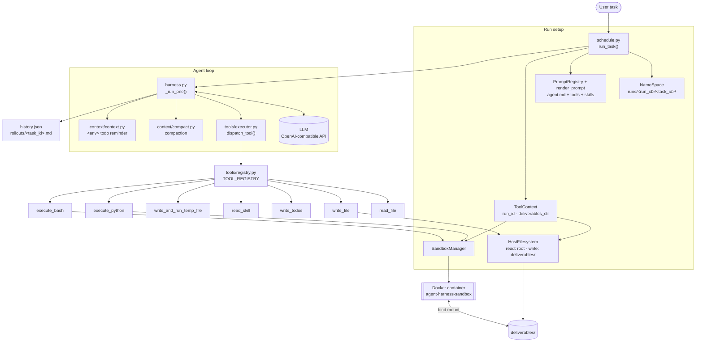
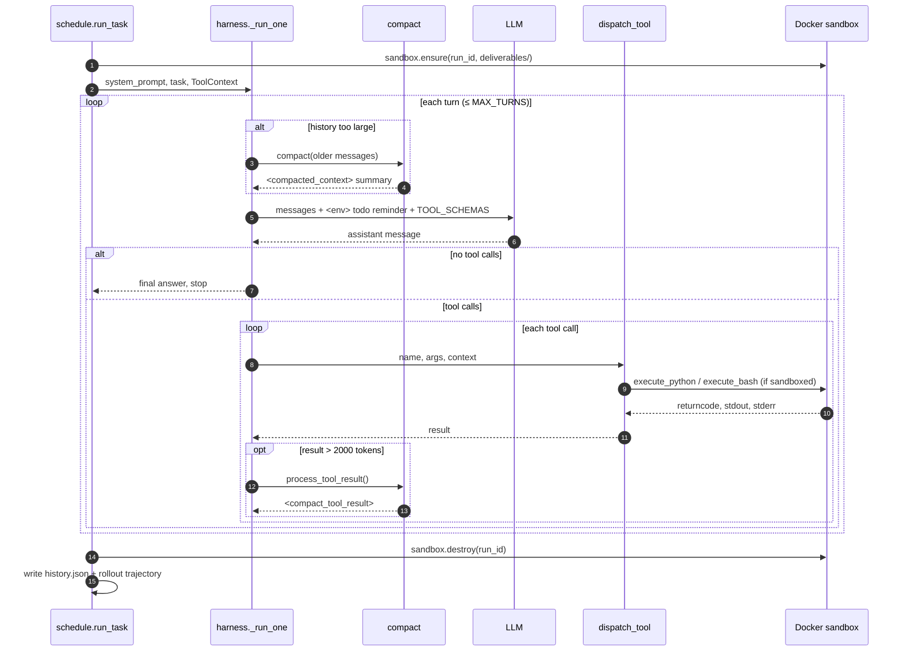
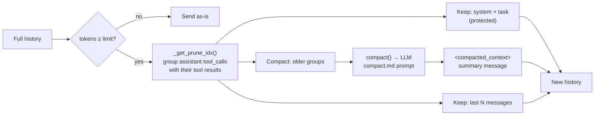
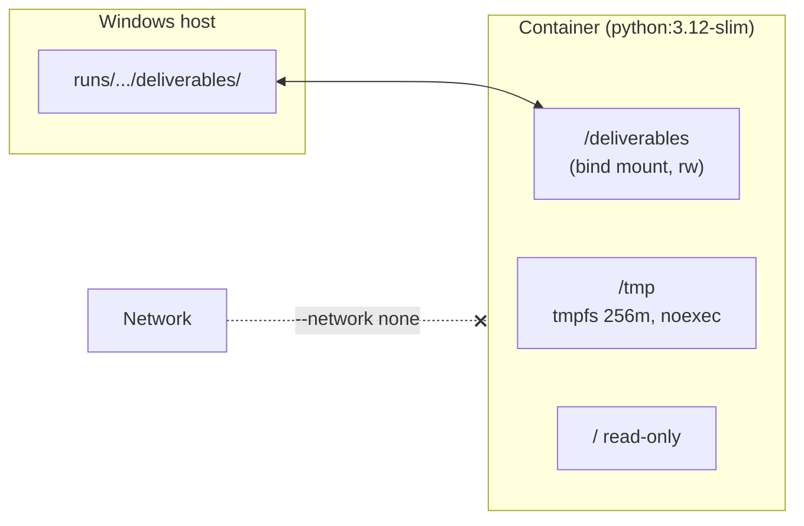

# Agent Harness

A minimal, from-scratch **LLM agent harness** in Python. It runs a tool-calling loop against any OpenAI-compatible endpoint (OpenRouter by default), executes code inside an **isolated Docker sandbox**, restricts host file writes to a per-run `deliverables/` folder, and keeps long runs alive with **automatic context compaction**.

No agent framework in the loop — just the OpenAI SDK, a tool registry, and a handful of small modules you can read in one sitting.

---

## Features

- **Tool-calling agent loop** — up to `MAX_TURNS` turns, stops when the model answers without calling tools.
- **Docker sandbox** — `execute_python` / `execute_bash` run in a locked-down container (no network, read-only root FS, dropped capabilities, non-root user, CPU/memory/PID limits).
- **Host filesystem guard** — `write_file` can only write inside the current run's `deliverables/` directory.
- **Context management**
  - Oversized tool results (> 2000 tokens) are summarized by the LLM before entering history.
  - When the conversation nears the context limit, older messages are compacted into a `<compacted_context>` summary — without ever splitting a tool call from its result.
- **Todo tracking** — `write_todos` keeps a plan that is re-injected every turn as an `<env>` reminder.
- **Skills** — Markdown playbooks in `skills/*/SKILL.md` with YAML frontmatter, listed in the system prompt and loaded on demand via `read_skill`.
- **Prompt templates** — `{{variable}}` templates in `prompt/templates/`.
- **Run artifacts** — every run saves its task, full message history, and a readable trajectory under `runs/`.

---

## Architecture



---

## Agent loop



---

## Context compaction



Rules enforced by `_get_prune_idx`:

- The first `protected_messages` (system prompt + task) are never compacted.
- An assistant message with `tool_calls` and all its `tool` results form one atomic group.
- At least `n_messages` recent messages are kept.
- If a previous `<compacted_context>` exists, compaction starts after it.

---

## Sandbox security



| Restriction | Setting |
|---|---|
| Network | `--network none` |
| Memory | `2g` (no extra swap) |
| CPU | `1` core |
| Processes | `--pids-limit 128` |
| Filesystem | `--read-only`, `/tmp` tmpfs `noexec,nosuid` |
| Privileges | `--cap-drop ALL`, `no-new-privileges`, user `10001:10001` |
| Per-call timeout | `timeout --signal=TERM --kill-after=2s <n>s` |

Each run gets its own container, named `agent-sandbox-<sha256(run_id)[:12]>`, created at the start of `run_task` and removed at the end.

---

## Project structure

```
agent-harness/
├── harness.py              # Agent loop (_run_one), LLM client, limits
├── schedule.py             # run_task(): run dirs, sandbox lifecycle, saving outputs
├── context/
│   ├── compact.py          # Token counting, tool-result & history compaction
│   ├── context.py          # <env> todo reminder injected every turn
│   └── trajectory.py       # Message history → readable trajectory text
├── prompt/
│   ├── registry.py         # PromptRegistry: loads templates/*.md
│   ├── render.py           # {{variable}} substitution
│   └── templates/
│       ├── agent.md        # Main system prompt
│       ├── compact.md      # History compaction prompt
│       └── compact_tool.md # Tool-result compaction prompt
├── tools/
│   ├── registry.py         # TOOL_REGISTRY + JSON schemas
│   ├── executor.py         # dispatch_tool(): parse args, inject context
│   ├── tools.py            # read_file, write_file, execute_*, temp runner
│   ├── todos.py            # write_todos / todos_prompt
│   ├── skills.py           # Skill discovery and read_skill
│   ├── host/
│   │   └── file_system.py  # HostFilesystem: allowed read/write roots
│   └── sandbox/
│       ├── Dockerfile      # Sandbox image
│       ├── docker_executor.py
│       ├── manager.py      # SandboxManager: ensure / execute / destroy
│       └── model.py        # ToolContext, SandboxConfig
├── skills/
│   ├── create-report/SKILL.md
│   └── decompose-task/SKILL.md
└── requirements.txt
```

---

## Tools

| Tool | Runs on | Description |
|---|---|---|
| `read_file` | Host | Read a text file. |
| `write_file` | Host (guarded) | `write` / `append` / `replace` a file inside `deliverables/` only. |
| `write_todos` | Memory | Replace the todo list (`pending` / `in_progress` / `done`, max one in progress). |
| `read_skill` | Host | Return the content of a skill by name. |
| `write_and_run_temp_file` | Host | Write a Python file to a temp dir, run it, delete it. |
| `execute_python` | Docker | Run Python code in the run's sandbox. |
| `execute_bash` | Docker | Run a Bash command in the run's sandbox. |

Add a tool by writing a function in `tools/` and registering its schema in `tools/registry.py`. If the function has a `context` parameter, `dispatch_tool` injects the run's `ToolContext` automatically.

---

## Setup

### 1. Python dependencies

```bash
pip install -r requirements.txt
pip install tiktoken pyyaml   # used by context/compact.py and tools/skills.py
```

### 2. Environment variables

Create a `.env` file in the project root (already git-ignored):

```env
BASE_URL=https://openrouter.ai/api/v1
OPENROUTER_API_KEY=sk-or-...
```

The model is set by `MODEL` in `harness.py` and `context/compact.py`.

### 3. Build the sandbox image

The Dockerfile copies a `requirements.txt` from the build context for packages available inside the sandbox. Put one next to the Dockerfile (it can be empty) and build:

```bash
cd tools/sandbox
# echo numpy > requirements.txt   # optional sandbox packages
docker build -t agent-harness-sandbox:latest .
```

---

## Usage

```python
from pathlib import Path
from prompt.registry import PromptRegistry
from tools.registry import list_tools
from tools.skills import skills_prompt
from schedule import run_task, NameSpace

root = Path(__file__).parent
registry = PromptRegistry(template_dir=root / "prompt" / "templates")

run_task(
    MAX_TURNS=50,
    prompt_registry=registry,
    prompt_name="agent",
    render_dict={"tools": list_tools(), "skills": skills_prompt()},
    task="Create a login page in a single file called test.html. Decompose into smaller tasks first, then implement.",
    root=root,
    name_space=NameSpace(task_id="login-page", seed=0, tag=""),
)
```

Pass `resume=Path(".../history/history.json")` to continue from a saved history.

### Run output

```
runs/
└── <task_id>-<dd-mm-yyyy_HH-MM-SS>/
    └── <task_id>/
        ├── task.md                  # The task text
        ├── deliverables/            # Files written by the agent (mounted in Docker)
        ├── history/history.json     # Full message history
        └── rollouts/<task_id>.md    # Readable trajectory: [ACTION] / [OBSERVATION] / [ASSISTANT]
```

---

## Skills

A skill is a folder under `skills/` with a `SKILL.md`:

```markdown
---
name: my-skill
description: When and why the agent should use this skill.
---

# Instructions
...
```

Names and descriptions go into the system prompt; the agent calls `read_skill("my-skill")` to load the full text when relevant.

---

## Notes

- Template paths in `harness.py` and `context/compact.py` are absolute Windows paths — change them if you move the project.
- `tools/skills.py` finds skills relative to the current working directory, so run from the project root.
- `agent.md` mentions `/workspace` and `write_temp_file`; the container actually mounts deliverables at `/deliverables`, and the registered temp tool is `write_and_run_temp_file`.
