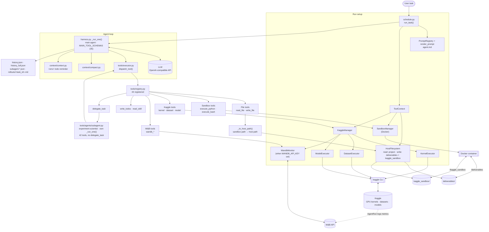
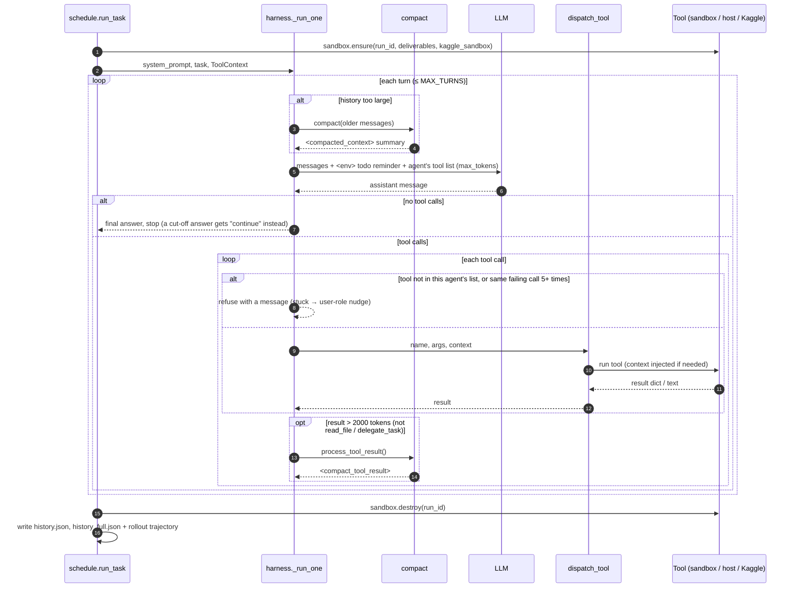
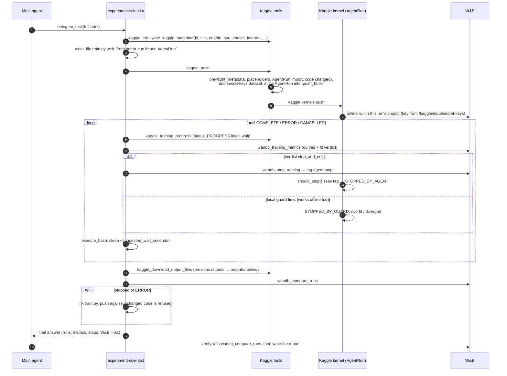
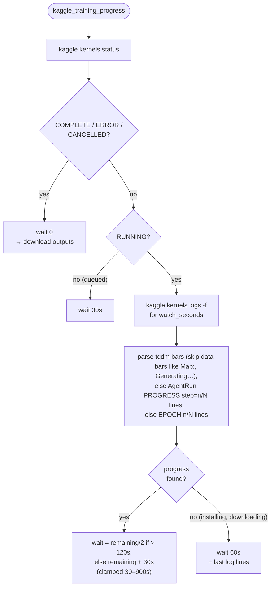
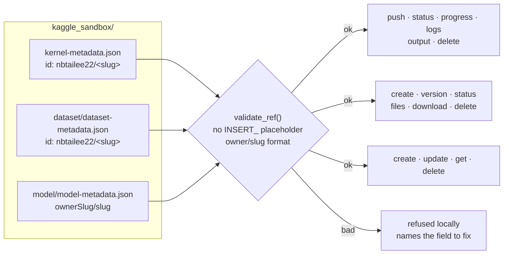
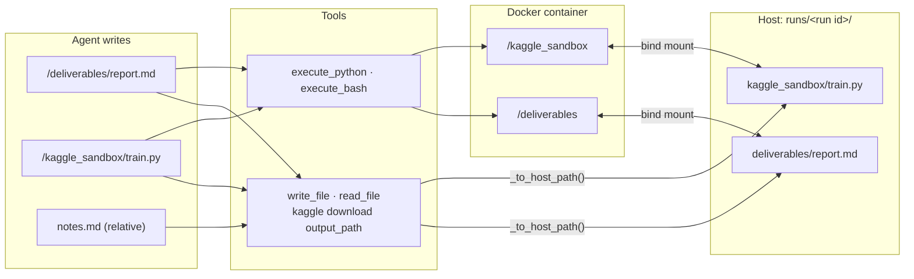
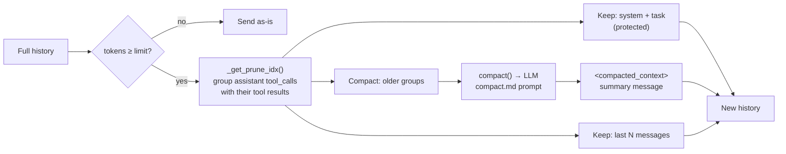

# Agent Harness

A minimal, from-scratch **LLM agent harness** in Python. It runs a tool-calling loop against any OpenAI-compatible endpoint (OpenRouter by default), executes code inside an **isolated Docker sandbox**, and runs **ML experiments on Kaggle GPUs tracked in W&B**: a main agent delegates each experiment to an `experiment-scientist` sub-agent, which writes the training script, pushes it, watches live metrics, stops bad runs early, and compares results.

No agent framework in the loop: just the OpenAI SDK, a tool registry, and a handful of small modules you can read in one sitting.

---

## Features

- **Tool-calling agent loop**: up to `MAX_TURNS` turns; stops when the model answers without calling a tool.
  - **Per-agent tool lists**: each agent only gets (and can only run) its own tools.
  - **Loop protections**: a raised output limit (`MAX_OUTPUT_TOKENS`, default 32000); a cut-off reply (`finish_reason == "length"`) is flagged to the model; the same failing call is warned about from the 3rd repeat and no longer executed from the 6th, with a user-role nudge to change approach.
  - **Full transcripts**: `history_full.json` and each sub-agent transcript keep every message, even after context compaction.
- **Docker sandbox**: `execute_python` / `execute_bash` run in a locked-down container (no network, read-only root filesystem, dropped capabilities, non-root user, CPU/memory/PID limits).
- **Kaggle training**: 27 Kaggle tools for kernels (remote training jobs), datasets and models, all scoped to one Kaggle account.
  - **Live progress**: `kaggle_training_progress` reads progress from the live kernel log (`AgentRun` `PROGRESS` lines, tqdm bars or `EPOCH n/N` lines) and tells the agent how long to sleep.
  - **Pre-flight checks**: placeholder ids, missing fields, bad slugs and a missing `train.py` are caught locally, before any Kaggle call. `kaggle_push` also refuses a `train.py` identical to the last push (unless `force=true`) and, while W&B is on, a script without `from agent_run import AgentRun` or with its own `class AgentRun`.
  - **AgentRun inlined at push**: `train.py` only imports `AgentRun`; `kaggle_push` uploads a build copy (`kaggle_sandbox/.push_build/`) with the real class inlined and the kernel slug and W&B project filled in.
  - **Keys without Kaggle Secrets**: the private dataset `nbtailee22/secret-keys` (`keys/.env` with `WANDB_API_KEY`) is added to every kernel's `dataset_sources`; the dataset tools refuse to touch it and downloaded `*.env` files are deleted.
  - **Metadata is the single source of truth**: every tool targets the id in its metadata file.
  - **Clear errors**: Kaggle's ambiguous 403 gets a "not found or private" hint; CLI output is decoded as UTF-8.
- **W&B training monitor** (optional): 9 `wandb_*` tools (entity fixed to `leductai2201`) read live metrics from a running kernel, flag overfit / underfit / divergence, stop a bad run early to save GPU time (from the agent via W&B, or by a local guard inside the kernel that also works offline), and rank runs by metric with their hyperparameters. The agent can also list and create projects, list runs and record its own runs. Works with PyTorch, Lightning, Hugging Face, XGBoost, LightGBM and sklearn. See [docs/wandb_integration.md](docs/wandb_integration.md).
- **Sub-agents**: the main agent delegates every experiment to `experiment-scientist` with `delegate_task`. The sub-agent (defined in `tools/agents/agent_registry.py`, role prompt `prompt/templates/experiment-scientist.md`) owns the full Kaggle + W&B workflow: `train.py`, push, live monitoring, early stops, comparison. The main agent keeps a short Kaggle/W&B guide and read-only tools (35 tools); the kernel-running tools (`EXPERIMENT_TOOLS` in `tools/registry.py`) are only given to the sub-agent (42 tools, no `delegate_task`). The sub-agent shares the run's sandbox, kernel and W&B project, its todo list does not overwrite the parent's, and its transcript is saved in `history/`.
- **No host code execution for agents**: `write_and_run_temp_file` stays registered but is in `HOST_ONLY_TOOLS`, so no agent can run Python on the host (where the API keys live).
- **One path style everywhere**: the agent uses sandbox paths (`/deliverables/...`, `/kaggle_sandbox/...`) in every tool; host tools translate them to the run's folders.
- **Host filesystem guard**: writes only inside the run's `deliverables/` and `kaggle_sandbox/`; reads only inside the project; `.env` is never readable.
- **Context management**
  - Oversized tool results (> 2000 tokens) are summarized by the LLM before entering history, except `read_file` (needs the real text) and `delegate_task` (already a summary).
  - Near the context limit, older messages are compacted into a `<compacted_context>` summary, never splitting a tool call from its result.
- **Todo tracking**: `write_todos` keeps a plan that is re-injected every turn as an `<env>` reminder.
- **Skills**: Markdown playbooks in `skills/*/SKILL.md`, listed in the system prompt and loaded on demand via `read_skill`.
- **Run artifacts**: every run saves its task, deliverables, Kaggle files, full message history and a readable trajectory under `runs/`.

---

## Architecture



---

## Agent loop



---

## Kaggle training

Experiments run on Kaggle's free GPUs, done by the `experiment-scientist` sub-agent. The Kaggle account is fixed in one constant, `KAGGLE_OWNER` in `tools/training_orchestrator/kaggle_executor.py` (currently `nbtailee22`); list tools always use it. W&B tracking is described in [docs/wandb_integration.md](docs/wandb_integration.md).

### Training workflow



### How `kaggle_training_progress` estimates the wait



Kaggle often writes tqdm frames to the log only when the run ends, so `AgentRun` prints a plain `PROGRESS step=12/150 elapsed=24.0s` line at most every 10 s.

### Metadata: single source of truth



### Kaggle tools

| Group | Tools |
|---|---|
| Kernel | `kaggle_init`, `write_kaggle_metadata`, `kaggle_push`, `kaggle_status`, `kaggle_training_progress`, `kaggle_list_output_files`, `kaggle_download_output_files`, `kaggle_get_output_log`, `kaggle_delete` |
| Dataset | `kaggle_dataset_init`, `write_kaggle_dataset_metadata`, `kaggle_dataset_read_metadata`, `kaggle_dataset_create`, `kaggle_dataset_version`, `kaggle_dataset_status`, `kaggle_dataset_list_files`, `kaggle_dataset_download`, `kaggle_dataset_delete`, `kaggle_list_available_dataset` |
| Model | `kaggle_model_init`, `write_kaggle_model_metadata`, `kaggle_model_read_metadata`, `kaggle_model_create`, `kaggle_model_update`, `kaggle_model_get`, `kaggle_model_list`, `kaggle_model_delete` |

Behaviour worth knowing:

- **Metadata writers are partial updates.** Only the arguments passed change. `*_sources` lists are kept unless given (`[]` clears one). `enable_gpu=true` sets `machine_shape: NvidiaTeslaT4`; `enable_gpu=false` removes it. `is_private` changes only when passed.
- **Real JSON booleans.** `kaggle * init` writes `"true"`/`"false"` strings; the init tools and every writer convert them.
- **`kaggle_download_output_files`**: `regex` is a regular expression (a glob like `*.csv` is converted). A full download (no `regex`) first moves the previous version's outputs to `output/archive/<time>/`. Any `*.env` file in the output is deleted. A failed log beautification is reported as `log_warning` and never turns a successful download into a failure. The log is found by the metadata slug.
- **`kaggle_get_output_log`**: logs over 6000 characters come back as head, key lines (errors, `WANDB_OFFLINE`, `STOPPED_BY_*`, metrics) and tail, with the full log's path.
- **`kaggle_training_progress`**: returns `status`, `progress` (`step`, `total_steps`, `percent`, `elapsed_seconds`, `remaining_seconds`, `epoch`, last log lines) and `suggested_wait_seconds`.
- **`nbtailee22/secret-keys`** is added to every kernel's `dataset_sources` on each metadata write and push; other sources are kept.
- **Deletes** need `confirm=True`; creating a public dataset needs `public=True`.

---

## Paths

The agent writes one path style everywhere. Host tools translate sandbox paths to the current run's folders:



| Path given | `write_file` | `read_file` | Kaggle `output_path` |
|---|---|---|---|
| `/deliverables/...`, `/kaggle_sandbox/...` | matching host folder | matching host folder | matching host folder |
| relative | under `/deliverables` | `/deliverables`, then project root | under `/kaggle_sandbox` |
| outside allowed folders | denied | denied | denied |

| Folder (sandbox) | Holds |
|---|---|
| `/deliverables` | reports, docs, final files; the sandbox working directory |
| `/kaggle_sandbox` | `kernel-metadata.json`, `train.py`, read-only copies of `agent_run.py` and `agent_run_adapters.py` |
| `/kaggle_sandbox/.push_build` | what was actually pushed: metadata + `train.py` with `AgentRun` inlined |
| `/kaggle_sandbox/dataset` | `dataset-metadata.json` and files to upload |
| `/kaggle_sandbox/model` | `model-metadata.json` |
| `/kaggle_sandbox/output` | kernel outputs, `<slug>.log`, `<slug>.pretty.log`, `wandb/`, `archive/<time>/` (previous versions), `datasets/`, `models/` |

---

## Context compaction



- The first `protected_messages` (system prompt + task) are never compacted.
- An assistant message with `tool_calls` and all its `tool` results form one atomic group.
- At least `n_messages` recent messages are kept; compaction starts after any earlier `<compacted_context>`.

---

## Sandbox security


| Restriction | Setting |
|---|---|
| Network | `--network none` (pip and downloads do not work in the sandbox; training with internet runs on Kaggle) |
| Memory / CPU / processes | `2g`, `1` core, `--pids-limit 128` |
| Filesystem | `--read-only`, `/tmp` tmpfs `noexec,nosuid` |
| Privileges | `--cap-drop ALL`, `no-new-privileges`, user `10001:10001` |
| Per-call timeout | `timeout --signal=TERM --kill-after=2s <n>s` |

Each run gets its own container, `agent-sandbox-<sha256(run_id)[:12]>`, created at the start of `run_task` and removed at the end.

---

## Project structure

```
agent-harness/
├── harness.py                  # Agent loop (_run_one), LLM client, limits, loop protections
├── schedule.py                 # run_task(): run dirs, sandbox + Kaggle + W&B setup, saving outputs
├── docs/
│   └── wandb_integration.md    # W&B design: AgentRun, monitor, tools, guard
├── context/
│   ├── compact.py              # Token counting, tool-result & history compaction
│   ├── context.py              # <env> todo reminder injected every turn
│   └── trajectory.py           # Message history → readable trajectory text
├── prompt/
│   ├── registry.py             # PromptRegistry: loads templates/*.md
│   ├── render.py               # {{variable}} substitution
│   ├── snippets/               # AgentRun (inlined by kaggle_push) + framework adapters
│   └── templates/
│       ├── agent.md            # Main system prompt (environment, paths, delegation, short Kaggle/W&B guide)
│       ├── experiment-scientist.md  # Sub-agent role: full Kaggle + W&B experiment workflow
│       ├── compact.md          # History compaction prompt
│       └── compact_tool.md     # Tool-result compaction prompt
├── tools/
│   ├── registry.py             # TOOL_REGISTRY (44), MAIN_TOOL_SCHEMAS, EXPERIMENT_TOOLS, HOST_ONLY_TOOLS
│   ├── executor.py             # dispatch_tool(): parse args, inject context
│   ├── agents/
│   │   ├── agent_registry.py   # AgentConfig + registered sub-agents (experiment-scientist)
│   │   └── subagent.py         # run_subagent(): child loop, prompt, tools, transcript
│   ├── tools.py                # Tool functions, path translation, Kaggle wrappers
│   ├── todos.py                # write_todos / todos_prompt
│   ├── skills.py               # Skill discovery and read_skill
│   ├── host/
│   │   └── file_system.py      # HostFilesystem: allowed read/write roots
│   ├── sandbox/
│   │   ├── Dockerfile          # Sandbox image
│   │   ├── docker_executor.py  # docker run / exec / rm
│   │   ├── manager.py          # SandboxManager: ensure / execute / destroy
│   │   └── model.py            # ToolContext, SandboxConfig
│   └── training_orchestrator/
│       ├── kaggle_executor.py  # Kernel/Dataset/ModelExecutor, validation, log + progress parsing
│       ├── kaggle_manager.py   # KaggleManager: bundles the executors + optional W&B monitor
│       └── wandb_monitor.py    # WandbMonitor, fit diagnosis (overfit / underfit / diverged)
├── skills/
│   ├── create-report/SKILL.md
│   └── decompose-task/SKILL.md
└── requirements.txt
```

---

## All tools

| Tool | Runs on | Description |
|---|---|---|
| `read_file` | Host (guarded) | Read a text file; sandbox or host paths. |
| `write_file` | Host (guarded) | `operation` is required: `write` / `append` (need `content`) or `replace` (needs `old_text`, `new_text`), inside `/deliverables` or `/kaggle_sandbox`. Empty content and misplaced arguments are refused, so nothing is overwritten by accident. |
| `delegate_task` | Main agent only | Run a registered sub-agent (`experiment-scientist`) on a self-contained brief; returns its final answer and transcript path. |
| `write_todos` | Memory | Replace the todo list (`pending` / `in_progress` / `done`, max one in progress). |
| `read_skill` | Host | Return a skill's instructions by name. |
| `write_and_run_temp_file` | Host | Runs Python on the host. Registered but **not given to agents** (`HOST_ONLY_TOOLS` in `tools/registry.py`): it would run with the host's API keys. |
| `execute_python` | Docker | Run Python code in the run's sandbox. |
| `execute_bash` | Docker | Run a Bash command in the run's sandbox. |
| `kaggle_*` (27) | Host → Kaggle CLI | See [Kaggle tools](#kaggle-tools). |
| `wandb_training_metrics`, `wandb_stop_training`, `wandb_compare_runs`, `wandb_sync_kaggle_run` | Host → W&B API | Live fit check, early stop, leaderboard, offline upload. On when `WANDB_API_KEY` is set; `WANDB_ENABLED=0` turns it off. |
| `wandb_list_projects`, `wandb_create_project`, `wandb_use_project`, `wandb_list_runs`, `wandb_create_run` | Host → W&B API | Browse and create projects, switch the active project, list runs, record a run from the host (`metrics` required; tagged `host`; may take a minute to appear in listings). |

Add a tool by writing a function in `tools/` and registering its schema in `tools/registry.py`. If the function has a `context` parameter, `dispatch_tool` injects the run's `ToolContext` automatically.

---

## Setup

### 1. Python dependencies

```bash
pip install -r requirements.txt     # includes wandb
pip install tiktoken pyyaml kaggle   # used by compaction, skills and the Kaggle tools
```

### 2. Environment variables

Create a `.env` file in the project root (git-ignored):

```env
BASE_URL=https://openrouter.ai/api/v1
OPENROUTER_API_KEY=sk-or-...
```

The model is set by `MODEL` in `harness.py` and `context/compact.py`.

Optional W&B monitoring. The entity is fixed to `leductai2201` in `tools/training_orchestrator/wandb_monitor.py`, and the host tools read the key from `WANDB_API_KEY`. Kernels get the key without Kaggle Secrets: upload once a private Kaggle dataset `nbtailee22/secret-keys` containing `keys/.env` with `WANDB_API_KEY=...`. It is attached to every kernel automatically and `AgentRun` loads it. The key is stored on Kaggle, so keep that dataset private and prefer a limited W&B key:

```env
WANDB_API_KEY=...   # turns W&B on (WANDB_ENABLED=0 turns it off)
```

Each `schedule.py` run creates its own W&B project named after the run id (e.g. `test-wb-26-11-2026_22-13-10`, the same name as the Kaggle kernel), and every training run of that task is logged into it.

### 3. Kaggle credentials

The Kaggle tools call the `kaggle` CLI (tested with 2.2.5) on the host. Authenticate it with `~/.kaggle/kaggle.json` or `KAGGLE_USERNAME` / `KAGGLE_KEY`, and set `KAGGLE_OWNER` in `tools/training_orchestrator/kaggle_executor.py` to that account. Check with:

```bash
kaggle kernels list --mine
```

### 4. Build the sandbox image

The Dockerfile copies a `requirements.txt` from the build context for packages available inside the sandbox. Put one next to the Dockerfile (it can be empty) and build:

```bash
cd tools/sandbox
# echo numpy > requirements.txt   # optional sandbox packages
docker build -t agent-harness-sandbox:latest .
```

---

## Usage

```python
from pathlib import Path
from prompt.registry import PromptRegistry
from tools.registry import list_tools
from tools.skills import skills_prompt
from schedule import run_task, NameSpace

root = Path(__file__).parent
registry = PromptRegistry(template_dir=root / "prompt" / "templates")

run_task(
    MAX_TURNS=50,
    prompt_registry=registry,
    prompt_name="agent",
    render_dict={"tools": list_tools(), "skills": skills_prompt()},
    task="Fine-tune distilbert-base-uncased on GLUE SST-2 on Kaggle (GPU T4) ...",
    root=root,
    name_space=NameSpace(task_id="sst2-quick", seed=0, tag=""),
)
```

Pass `resume=Path(".../history/history.json")` to continue from a saved history.

### Example Kaggle task

A quick end-to-end check of the training feature (about 3–4 minutes on a T4):

```text
Fine-tune distilbert-base-uncased on GLUE SST-2 on Kaggle (GPU T4, internet on)
and report validation accuracy. Target >= 86%.

- Kernel id nbtailee22/sst2-quick, code_file train.py.
- train.py: load_dataset("nyu-mll/glue", "sst2"), train on the first 10000 rows
  of the train split, evaluate on the full validation split. Hugging Face
  Trainer, max_length 64, batch 32, lr 3e-5, 1 epoch, fp16, seed 42,
  output_dir /kaggle/temp. Print the GPU name and a final line
  FINAL val_accuracy=<value>. Save only metrics.json to /kaggle/working.
- Push, monitor until COMPLETE, fix and re-push on ERROR.
- Download metrics.json and the log and report accuracy and train time.
```

A previous run of this task reached 86.9% validation accuracy in 29 s of training.

### Run output

```
runs/
└── <task_id>-<dd-mm-yyyy_HH-MM-SS>/   # run id: also the W&B project name
    ├── task.md                        # The task text
    ├── deliverables/                  # Files written by the agents (/deliverables)
    ├── kaggle_sandbox/                # Kaggle working folder (/kaggle_sandbox)
    │   ├── kernel-metadata.json
    │   ├── train.py                   # imports AgentRun
    │   ├── agent_run.py  agent_run_adapters.py   # read-only copies for the agent
    │   ├── .push_build/               # what was actually pushed (AgentRun inlined)
    │   ├── dataset/  model/
    │   └── output/                    # latest kernel outputs, logs, wandb/, archive/<time>/
    ├── history/
    │   ├── history.json               # Main agent history as sent (compacted; used by resume)
    │   ├── history_full.json          # Every message, uncompacted
    │   └── subagent-<name>-<time>.json   # Full transcript of each delegation
    └── rollouts/<task_id>.md          # Readable trajectory: [ACTION] / [OBSERVATION] / [ASSISTANT]
```

---

## Skills

A skill is a folder under `skills/` with a `SKILL.md`:

```markdown
---
name: my-skill
description: When and why the agent should use this skill.
---

# Instructions
...
```

Names and descriptions go into the system prompt; the agent calls `read_skill("my-skill")` to load the full text when relevant.

---

## Notes

- Template paths in `harness.py` and `context/compact.py` are absolute Windows paths; change them if you move the project.
- `tools/skills.py` finds skills relative to the current working directory, so run from the project root.
- The Kaggle image runs the newest libraries (transformers 5.x, datasets 4.x): use namespaced Hub dataset ids such as `nyu-mll/glue`, and `Trainer(processing_class=...)`.
- Kaggle T4 machines have 2 GPUs; `Trainer` uses both, so the effective batch is per-device batch × 2 unless `train.py` sets `CUDA_VISIBLE_DEVICES=0`.
- `kaggle_training_progress` while a kernel is `RUNNING` relies on `kaggle kernels logs -f`; with `AgentRun`'s `PROGRESS` lines it has worked on live CPU kernels.
- The model tends to drop `content` from `write_file` calls when `operation` is omitted, which is why `operation` is required; long files should be written in ~3000-character sections (`write`, then `append`).
