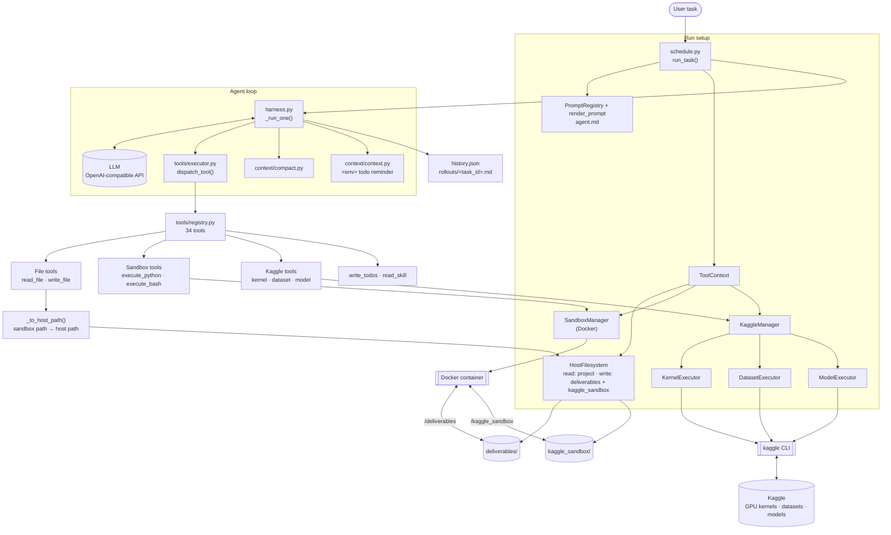
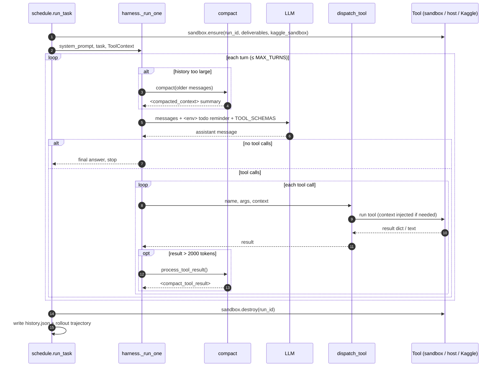
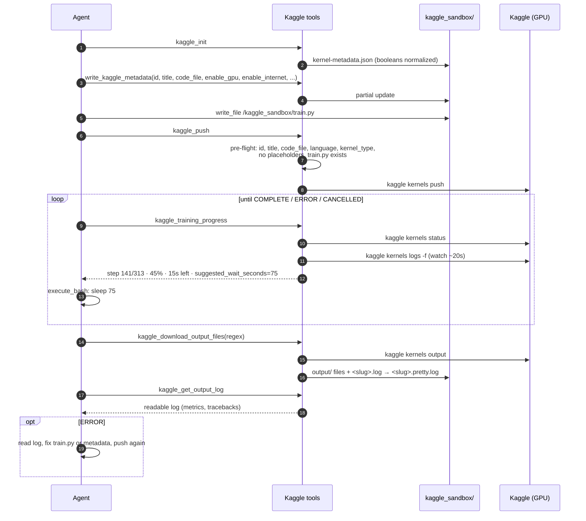
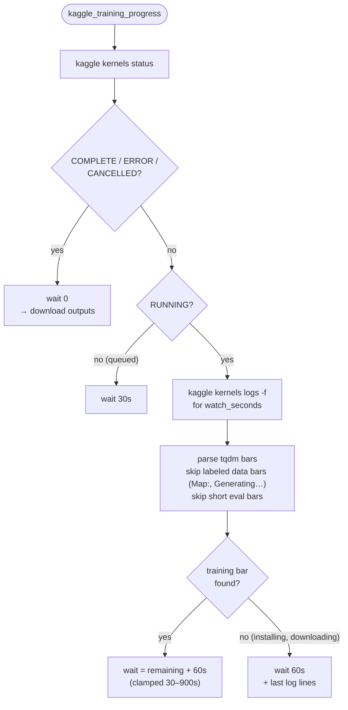
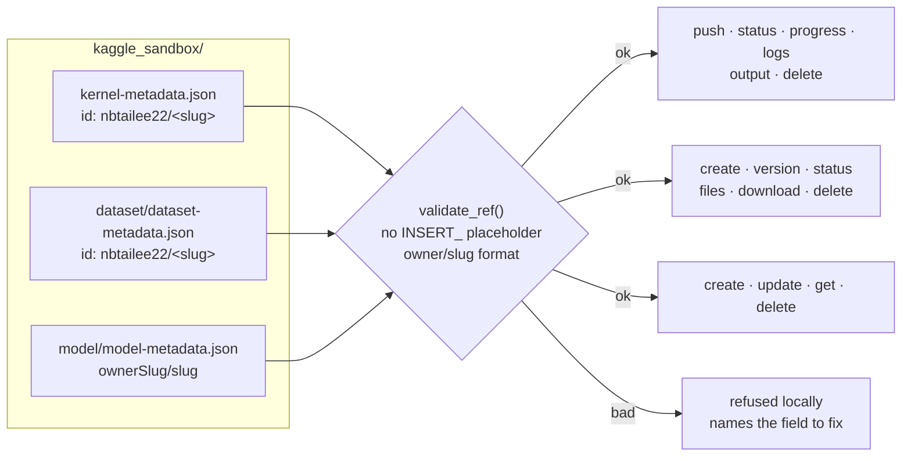
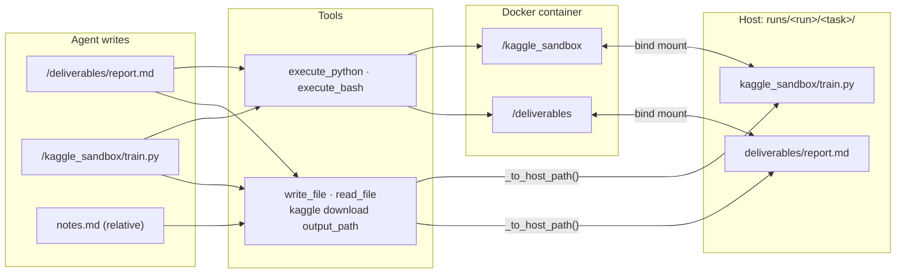
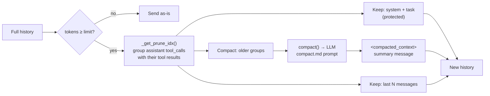
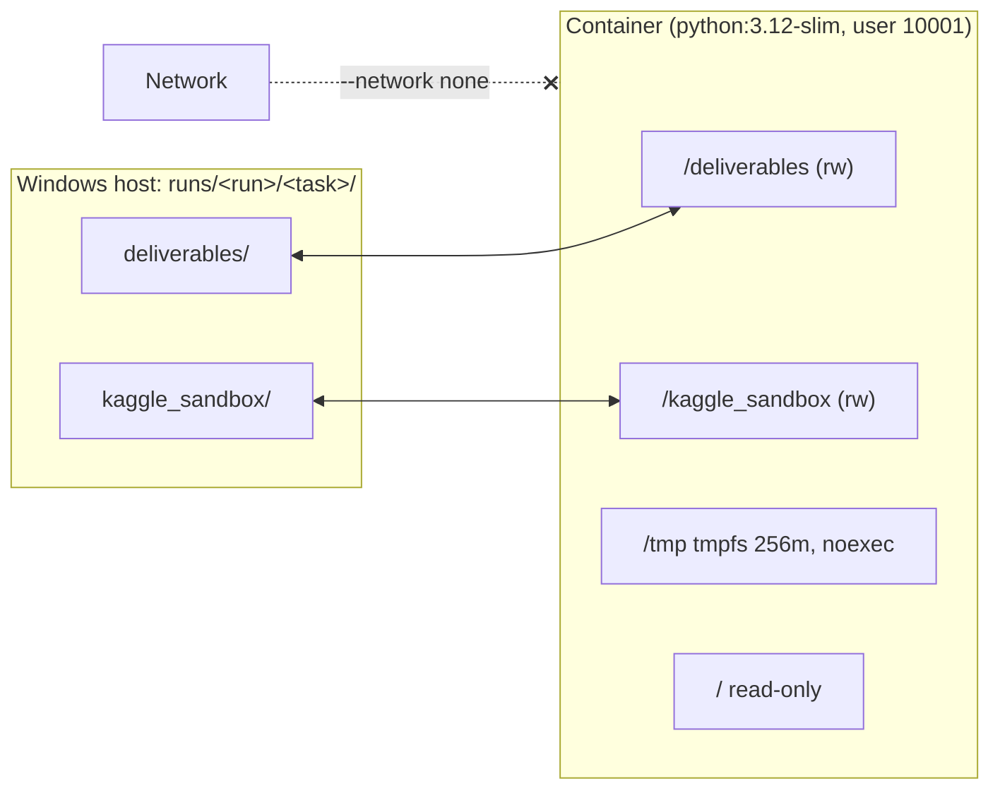

# Agent Harness

A minimal, from-scratch **LLM agent harness** in Python. It runs a tool-calling loop against any OpenAI-compatible endpoint (OpenRouter by default), executes code inside an **isolated Docker sandbox**, and can **train models remotely on Kaggle GPUs**: write a training script, push it, watch its progress, and collect the results.

No agent framework in the loop: just the OpenAI SDK, a tool registry, and a handful of small modules you can read in one sitting.

---

## Features

- **Tool-calling agent loop**: up to `MAX_TURNS` turns; stops when the model answers without calling a tool.
- **Docker sandbox**: `execute_python` / `execute_bash` run in a locked-down container (no network, read-only root filesystem, dropped capabilities, non-root user, CPU/memory/PID limits).
- **Kaggle training**: 27 Kaggle tools for kernels (remote training jobs), datasets and models, all scoped to one Kaggle account.
  - **Live progress**: `kaggle_training_progress` reads the training progress bar from the live kernel log and tells the agent exactly how long to sleep.
  - **Pre-flight checks**: placeholder ids, missing fields, bad slugs and a missing `train.py` are caught locally, before any Kaggle call.
  - **Metadata is the single source of truth**: every tool targets the id in its metadata file.
  - **Clear errors**: Kaggle's ambiguous 403 gets a "not found or private" hint; CLI output is decoded as UTF-8.
- **One path style everywhere**: the agent uses sandbox paths (`/deliverables/...`, `/kaggle_sandbox/...`) in every tool; host tools translate them to the run's folders.
- **Host filesystem guard**: writes only inside the run's `deliverables/` and `kaggle_sandbox/`; reads only inside the project; `.env` is never readable.
- **Context management**
  - Oversized tool results (> 2000 tokens) are summarized by the LLM before entering history.
  - Near the context limit, older messages are compacted into a `<compacted_context>` summary, never splitting a tool call from its result.
- **Todo tracking**: `write_todos` keeps a plan that is re-injected every turn as an `<env>` reminder.
- **Skills**: Markdown playbooks in `skills/*/SKILL.md`, listed in the system prompt and loaded on demand via `read_skill`.
- **Run artifacts**: every run saves its task, deliverables, Kaggle files, full message history and a readable trajectory under `runs/`.

---

## Architecture



---

## Agent loop



---

## Kaggle training

The agent trains models on Kaggle's free GPUs. The Kaggle account is fixed in one constant, `KAGGLE_OWNER` in `tools/training_orchestrator/kaggle_executor.py` (currently `nbtailee22`); list tools always use it.

### Training workflow



### How `kaggle_training_progress` estimates the wait



### Metadata: single source of truth



### Kaggle tools

| Group | Tools |
|---|---|
| Kernel | `kaggle_init`, `write_kaggle_metadata`, `kaggle_push`, `kaggle_status`, `kaggle_training_progress`, `kaggle_list_output_files`, `kaggle_download_output_files`, `kaggle_get_output_log`, `kaggle_delete` |
| Dataset | `kaggle_dataset_init`, `write_kaggle_dataset_metadata`, `kaggle_dataset_read_metadata`, `kaggle_dataset_create`, `kaggle_dataset_version`, `kaggle_dataset_status`, `kaggle_dataset_list_files`, `kaggle_dataset_download`, `kaggle_dataset_delete`, `kaggle_list_available_dataset` |
| Model | `kaggle_model_init`, `write_kaggle_model_metadata`, `kaggle_model_read_metadata`, `kaggle_model_create`, `kaggle_model_update`, `kaggle_model_get`, `kaggle_model_list`, `kaggle_model_delete` |

Behaviour worth knowing:

- **Metadata writers are partial updates.** Only the arguments passed change. `*_sources` lists are kept unless given (`[]` clears one). `enable_gpu=true` sets `machine_shape: NvidiaTeslaT4`; `enable_gpu=false` removes it. `is_private` changes only when passed.
- **Real JSON booleans.** `kaggle * init` writes `"true"`/`"false"` strings; the init tools and every writer convert them.
- **`kaggle_download_output_files`**: `regex` is a regular expression (a glob like `*.csv` is converted). A failed log beautification is reported as `log_warning` and never turns a successful download into a failure. The log is found by the metadata slug.
- **`kaggle_training_progress`**: returns `status`, `progress` (`step`, `total_steps`, `percent`, `elapsed_seconds`, `remaining_seconds`, `epoch`, last log lines) and `suggested_wait_seconds`. The training script must keep the Trainer's tqdm bar on.
- **Deletes** need `confirm=True`; creating a public dataset needs `public=True`.

---

## Paths

The agent writes one path style everywhere. Host tools translate sandbox paths to the current run's folders:



| Path given | `write_file` | `read_file` | Kaggle `output_path` |
|---|---|---|---|
| `/deliverables/...`, `/kaggle_sandbox/...` | matching host folder | matching host folder | matching host folder |
| relative | under `/deliverables` | `/deliverables`, then project root | under `/kaggle_sandbox` |
| outside allowed folders | denied | denied | denied |

| Folder (sandbox) | Holds |
|---|---|
| `/deliverables` | reports, docs, final files; the sandbox working directory |
| `/kaggle_sandbox` | `kernel-metadata.json`, `train.py` |
| `/kaggle_sandbox/dataset` | `dataset-metadata.json` and files to upload |
| `/kaggle_sandbox/model` | `model-metadata.json` |
| `/kaggle_sandbox/output` | kernel outputs, `<slug>.log`, `<slug>.pretty.log`, `datasets/`, `models/` |

---

## Context compaction



- The first `protected_messages` (system prompt + task) are never compacted.
- An assistant message with `tool_calls` and all its `tool` results form one atomic group.
- At least `n_messages` recent messages are kept; compaction starts after any earlier `<compacted_context>`.

---

## Sandbox security



| Restriction | Setting |
|---|---|
| Network | `--network none` (pip and downloads do not work in the sandbox; training with internet runs on Kaggle) |
| Memory / CPU / processes | `2g`, `1` core, `--pids-limit 128` |
| Filesystem | `--read-only`, `/tmp` tmpfs `noexec,nosuid` |
| Privileges | `--cap-drop ALL`, `no-new-privileges`, user `10001:10001` |
| Per-call timeout | `timeout --signal=TERM --kill-after=2s <n>s` |

Each run gets its own container, `agent-sandbox-<sha256(run_id)[:12]>`, created at the start of `run_task` and removed at the end.

---

## Project structure

```
agent-harness/
├── harness.py                  # Agent loop (_run_one), LLM client, limits
├── schedule.py                 # run_task(): run dirs, sandbox + Kaggle setup, saving outputs
├── context/
│   ├── compact.py              # Token counting, tool-result & history compaction
│   ├── context.py              # <env> todo reminder injected every turn
│   └── trajectory.py           # Message history → readable trajectory text
├── prompt/
│   ├── registry.py             # PromptRegistry: loads templates/*.md
│   ├── render.py               # {{variable}} substitution
│   └── templates/
│       ├── agent.md            # Main system prompt (environment, paths, Kaggle workflows)
│       ├── compact.md          # History compaction prompt
│       └── compact_tool.md     # Tool-result compaction prompt
├── tools/
│   ├── registry.py             # TOOL_REGISTRY + JSON schemas (34 tools)
│   ├── executor.py             # dispatch_tool(): parse args, inject context
│   ├── tools.py                # Tool functions, path translation, Kaggle wrappers
│   ├── todos.py                # write_todos / todos_prompt
│   ├── skills.py               # Skill discovery and read_skill
│   ├── host/
│   │   └── file_system.py      # HostFilesystem: allowed read/write roots
│   ├── sandbox/
│   │   ├── Dockerfile          # Sandbox image
│   │   ├── docker_executor.py  # docker run / exec / rm
│   │   ├── manager.py          # SandboxManager: ensure / execute / destroy
│   │   └── model.py            # ToolContext, SandboxConfig
│   └── training_orchestrator/
│       ├── kaggle_executor.py  # Kernel/Dataset/ModelExecutor, validation, log + progress parsing
│       └── kaggle_manager.py   # KaggleManager: bundles the three executors
├── skills/
│   ├── create-report/SKILL.md
│   └── decompose-task/SKILL.md
└── requirements.txt
```

---

## All tools

| Tool | Runs on | Description |
|---|---|---|
| `read_file` | Host (guarded) | Read a text file; sandbox or host paths. |
| `write_file` | Host (guarded) | `write` (default) / `append` / `replace` inside `/deliverables` or `/kaggle_sandbox`. |
| `write_todos` | Memory | Replace the todo list (`pending` / `in_progress` / `done`, max one in progress). |
| `read_skill` | Host | Return a skill's instructions by name. |
| `write_and_run_temp_file` | Host | Write a Python file to a temp dir, run it on the host, delete it. |
| `execute_python` | Docker | Run Python code in the run's sandbox. |
| `execute_bash` | Docker | Run a Bash command in the run's sandbox. |
| `kaggle_*` (27) | Host → Kaggle CLI | See [Kaggle tools](#kaggle-tools). |

Add a tool by writing a function in `tools/` and registering its schema in `tools/registry.py`. If the function has a `context` parameter, `dispatch_tool` injects the run's `ToolContext` automatically.

---

## Setup

### 1. Python dependencies

```bash
pip install -r requirements.txt
pip install tiktoken pyyaml kaggle   # used by compaction, skills and the Kaggle tools
```

### 2. Environment variables

Create a `.env` file in the project root (git-ignored):

```env
BASE_URL=https://openrouter.ai/api/v1
OPENROUTER_API_KEY=sk-or-...
```

The model is set by `MODEL` in `harness.py` and `context/compact.py`.

### 3. Kaggle credentials

The Kaggle tools call the `kaggle` CLI (tested with 2.2.5) on the host. Authenticate it with `~/.kaggle/kaggle.json` or `KAGGLE_USERNAME` / `KAGGLE_KEY`, and set `KAGGLE_OWNER` in `tools/training_orchestrator/kaggle_executor.py` to that account. Check with:

```bash
kaggle kernels list --mine
```

### 4. Build the sandbox image

The Dockerfile copies a `requirements.txt` from the build context for packages available inside the sandbox. Put one next to the Dockerfile (it can be empty) and build:

```bash
cd tools/sandbox
# echo numpy > requirements.txt   # optional sandbox packages
docker build -t agent-harness-sandbox:latest .
```

---

## Usage

```python
from pathlib import Path
from prompt.registry import PromptRegistry
from tools.registry import list_tools
from tools.skills import skills_prompt
from schedule import run_task, NameSpace

root = Path(__file__).parent
registry = PromptRegistry(template_dir=root / "prompt" / "templates")

run_task(
    MAX_TURNS=50,
    prompt_registry=registry,
    prompt_name="agent",
    render_dict={"tools": list_tools(), "skills": skills_prompt()},
    task="Fine-tune distilbert-base-uncased on GLUE SST-2 on Kaggle (GPU T4) ...",
    root=root,
    name_space=NameSpace(task_id="sst2-quick", seed=0, tag=""),
)
```

Pass `resume=Path(".../history/history.json")` to continue from a saved history.

### Example Kaggle task

A quick end-to-end check of the training feature (about 3–4 minutes on a T4):

```text
Fine-tune distilbert-base-uncased on GLUE SST-2 on Kaggle (GPU T4, internet on)
and report validation accuracy. Target >= 86%.

- Kernel id nbtailee22/sst2-quick, code_file train.py.
- train.py: load_dataset("nyu-mll/glue", "sst2"), train on the first 10000 rows
  of the train split, evaluate on the full validation split. Hugging Face
  Trainer, max_length 64, batch 32, lr 3e-5, 1 epoch, fp16, seed 42,
  output_dir /kaggle/temp. Print the GPU name and a final line
  FINAL val_accuracy=<value>. Save only metrics.json to /kaggle/working.
- Push, monitor until COMPLETE, fix and re-push on ERROR.
- Download metrics.json and the log and report accuracy and train time.
```

A previous run of this task reached 86.9% validation accuracy in 29 s of training.

### Run output

```
runs/
└── <task_id>-<dd-mm-yyyy_HH-MM-SS>/
    └── <task_id>/
        ├── task.md                    # The task text
        ├── deliverables/              # Files written by the agent (/deliverables)
        ├── kaggle_sandbox/            # Kaggle working folder (/kaggle_sandbox)
        │   ├── kernel-metadata.json
        │   ├── train.py
        │   ├── dataset/  model/
        │   └── output/                # metrics, <slug>.log, <slug>.pretty.log
        ├── history/history.json       # Full message history
        └── rollouts/<task_id>.md      # Readable trajectory: [ACTION] / [OBSERVATION] / [ASSISTANT]
```

---

## Skills

A skill is a folder under `skills/` with a `SKILL.md`:

```markdown
---
name: my-skill
description: When and why the agent should use this skill.
---

# Instructions
...
```

Names and descriptions go into the system prompt; the agent calls `read_skill("my-skill")` to load the full text when relevant.

---

## Notes

- Template paths in `harness.py` and `context/compact.py` are absolute Windows paths; change them if you move the project.
- `tools/skills.py` finds skills relative to the current working directory, so run from the project root.
- The Kaggle image runs the newest libraries (transformers 5.x, datasets 4.x): use namespaced Hub dataset ids such as `nyu-mll/glue`, and `Trainer(processing_class=...)`.
- Kaggle T4 machines have 2 GPUs; `Trainer` uses both, so the effective batch is per-device batch × 2 unless `train.py` sets `CUDA_VISIBLE_DEVICES=0`.
- `kaggle_training_progress` while a kernel is `RUNNING` relies on `kaggle kernels logs -f`; it has been verified on finished kernels so far.
